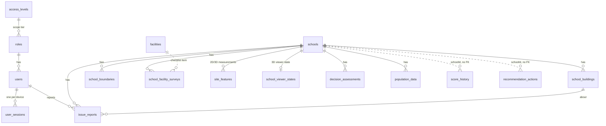

# TVET 3D GIS — Database Architecture

**Engine:** PostgreSQL 15 + PostGIS 3.4 · **Access layer:** TypeORM (NestJS) · **Updated:** 20 October 2026

---

## 1. Overview

- **One relational database** holds every school record, user, score and audit entry.
- **Large files stay out of the database.** KMZ files, 3D models (GLB) and drone imagery are kept in object storage (MinIO / S3). The database stores only their paths and metadata.
- **Map shapes are stored as GeoJSON in `jsonb` columns**, plus latitude/longitude columns. PostGIS is installed but its geometry type is not used yet (see §5).
- **Every schema change ships as a versioned migration** (`server/src/migrations/`). Production never auto-syncs the schema.

---

## 2. Entity relationship diagram

Solid lines are enforced foreign keys. Dotted lines are links by ID with no foreign key.

---

## 3. Tables by domain

### Identity and access

| Table | Holds |
|---|---|
| `access_levels` | Scope tiers: National ▸ Province ▸ District ▸ Sector ▸ School (`slug`, `rank`) |
| `roles` | Role name, its permission list, and its access level. `seededPermissions` records what the seed has already granted, so admin edits are never overwritten. |
| `users` | Profile, password hash and password history, lockout counters, encrypted two-factor (TOTP) secret and recovery codes, Google link, privacy-notice acceptance |
| `user_sessions` | One row per signed-in device: hashed refresh token, rotation history, IP, user agent, expiry and revocation |

### Core domain

| Table | Holds |
|---|---|
| `schools` | The school register, 66 columns: code, type, status; location (province → village, lat/lng); students and staff by gender; land and road access; programmes; score and priority; KMZ, 3D model and imagery file paths and processing status |
| `school_buildings` | One row per building: function, floors, area, year built, condition and roof condition, footprint (GeoJSON), centroid, 3D model path and metadata |
| `school_boundaries` | Campus boundary polygons extracted from KMZ files: GeoJSON, area, centroid, source file |
| `facilities` | The facility checklist template (e.g. washrooms, ICT, fire safety), stored as `jsonb` items |

### Field data

| Table | Holds |
|---|---|
| `school_facility_surveys` | Compliance result per school, per checklist item, with inspector and date |
| `issue_reports` | Reported issues and "Request a change" items for data corrections: category, status, attachments, linked building, assigned role |

### GIS and 3D viewer

| Table | Holds |
|---|---|
| `site_features` | Measurements, notes and pins. Each is stored twice: as WGS84 GeoJSON for the 2D map and as model coordinates for the 3D viewer, so the two views stay in sync. Records who created and last edited it. |
| `school_viewer_states` | One row per school: 3D camera "home" view and building pins |

### Analytics

| Table | Holds |
|---|---|
| `decision_assessments` | Condition score per school: the 6 factor scores, overall score, priority band, recommendations, estimated budget (RWF), urgency, data-gap flags |
| `score_history` | Score snapshots over time, for trend charts |
| `recommendation_actions` | Follow-up actions: assignee, due date, status |
| `population_data` | Population within 500 m, 1 km and 2 km of the school, school-age population, density. Source: ArcGIS. |

### Governance

| Table | Holds |
|---|---|
| `audit_logs` | One row per action: actor, role, IP, session, action, outcome, target, affected user, field-level changes. Each row stores a hash linked to the previous row (`prev_hash` → `hash`). |
| `migrations` | Applied schema versions (TypeORM) |

---

## 4. Integrity and security controls

- **Tamper-evident audit log.** Each row's hash includes the previous row's hash, and `GET /audit-logs/verify` re-checks the whole chain. In production, database triggers (`trg_audit_logs_append_only`, `trg_audit_logs_no_truncate`) block any `UPDATE`, `DELETE` or `TRUNCATE` on the table. Migration `1788430000000-AuditTrailWs11` creates them.
- **No secrets in plain text.** Passwords, refresh tokens and email codes are stored only as hashes. TOTP secrets are encrypted with `TOTP_ENCRYPTION_KEY`.
- **Scope filtering.** Queries are filtered by the user's access level and location (National → School), and analytics count active schools only.
- **Cascade deletes.** Child tables with foreign keys are removed when their school is deleted.

---

## 5. Known limitations and recommendations

| # | Limitation | Recommendation |
|---|---|---|
| 1 | Map shapes are stored as `jsonb`, so the database can't do spatial queries or spatial indexing | Add PostGIS `geometry` columns with GIST indexes when spatial queries are needed (catchment search, "schools within X km") |
| 2 | `score_history`, `recommendation_actions` and `population_data.schoolId` link to schools by a plain `varchar` ID with no foreign key, so deleting a school leaves orphan rows | Migrate them to `uuid` foreign keys with `ON DELETE CASCADE` |
| 3 | `schools` is a wide table (66 columns) that mixes register, demographic and file-processing data | Move file and processing status into a separate `school_assets` table as more file types are added |
| 4 | Local development databases are built by auto-sync, so they lack the audit triggers | Run migrations on staging and test databases to mirror production |

---

*Related:* [PROJECT_SUMMARY.md](PROJECT_SUMMARY.md) · [METRIC_DICTIONARY.md](METRIC_DICTIONARY.md) · [PERSONAL_DATA_INVENTORY.md](PERSONAL_DATA_INVENTORY.md) · [BACKUP_AND_DR.md](BACKUP_AND_DR.md)
