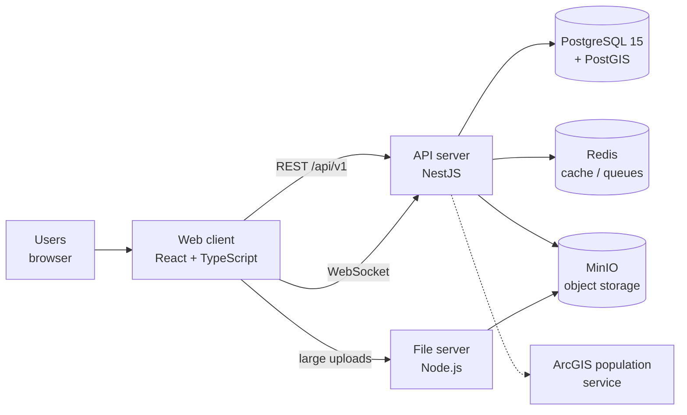

# TVET 3D GIS — Project Summary

**Client:** Rwanda TVET Board (RTB) · **Status:** Live in production (since Oct 2026) · **Updated:** 20 October 2026

---

## 1. What it is

A web-based **geospatial monitoring and decision-support platform** for Rwanda's Technical and Vocational Education and Training (TVET) schools.

It brings every school's data, location, buildings, 3D models and drone imagery into one place. Officials can **see** each school on a map and in 3D, **measure** it, and **decide** where to invest first.

---

## 2. The problem it solves

| Before | With TVET 3D GIS |
|---|---|
| School data scattered across spreadsheets, reports and field visits | One national register of schools: about 50 fields per school (location, facilities, utilities, staff, programmes) |
| No visual picture of campuses; site visits needed to judge conditions | 2D maps, 3D campus models and drone orthophotos, viewable from the office |
| Investment priorities set case by case, hard to justify | A transparent **School Condition Score** (0–100) and **Intervention Priority** bands |
| No link between schools and the population they serve | Population density and catchment analytics |
| Little traceability of who changed what | A full, tamper-evident audit trail of every action |

---

## 3. Who uses it

| Role | Scope | Typical use |
|---|---|---|
| Super Admin / Admin | National | Users, roles, configuration, audit |
| GIS Analyst | National | KMZ/3D uploads, data quality, analytics |
| Viewer | National | Read-only dashboards and maps |
| District Officer | One district | Monitor and report on the district's schools |
| School Leader | One school | Keep school data current; request corrections |

Access follows a geographic hierarchy (**National ▸ Province ▸ District ▸ Sector ▸ School**). Each user sees only the data in their scope.

---

## 4. Key capabilities

1. **School data management:** create and edit school records, with field-level permissions and a "Request a change" workflow.
2. **National map:** every school on an interactive 2D map with filters.
3. **3D campus explorer:** optimised 3D building models, with measurement tools, notes and pins. 2D and 3D stay in sync.
4. **KMZ/KML processing:** upload geospatial files; building footprints and boundaries are extracted automatically.
5. **Decision dashboard:** condition score, priority bands, risk view and data-gap flags.
6. **Population analytics:** demand and catchment pressure around each school.
7. **Facility surveys and reporting:** school reports, exports and change requests.
8. **Security and audit:** two-factor authentication, session control, and a hash-chained audit log.

### The School Condition Score

| Factor | Weight |
|---|---|
| Infrastructure condition | 35% |
| Building age | 25% |
| Facility compliance | 15% |
| Accessibility | 10% |
| Population pressure | 10% |
| Issue resolution | 5% |

**Intervention Priority:** Critical < 35 · High < 55 · Medium < 75 · Low ≥ 75.
Where data is missing, the factor scores a neutral 50 and is clearly flagged. Every formula is documented in `docs/METRIC_DICTIONARY.md`.

---

## 5. Architecture

| Layer | Technology | Responsibility |
|---|---|---|
| Web client | React 19, TypeScript, Vite, Tailwind | User interface, dashboards |
| Maps and 3D | OpenLayers (2D), three.js and CesiumJS (3D) | Maps, 3D campuses, measurements |
| API | NestJS (modular monolith), TypeORM | Business logic, scoring, security, audit |
| Database | PostgreSQL 15 + PostGIS 3.4 | School records and geospatial data |
| Storage | MinIO (S3-compatible) | KMZ files, 3D models, imagery |
| Cache and queues | Redis 7, BullMQ | Performance, background processing |
| File server | Node.js | Authenticated large-file uploads |
| 3D pipeline | glTF/Meshopt optimiser | Shrinks raw 3D models about 30× for fast loading |

**Main backend modules:** Auth, Users and Roles, Schools, KMZ, Analytics, Site Features (2D/3D tools), Population, Reports, Audit, Storage.

---

## 6. Security and compliance

- Short-lived access tokens (15 min) plus rotating refresh tokens in secure cookies.
- Two-factor authentication (TOTP), mandatory for privileged roles. Account lockout after 5 failed attempts. Enforced password policy.
- Role-based permissions (about 37 of them), enforced on every API route and covered by automated tests.
- Tamper-evident audit trail: one record per action (who, what, when, to whom), hash-chained and verifiable.
- Upload validation (file type checks, zip-bomb protection) and request size limits.
- Compliance work against Rwanda's data protection law (Law 058/2021) and RISA guidance: privacy notice, personal data inventory, breach response runbook, backup and disaster recovery plan.

---

## 7. Delivery and quality

- **CI/CD:** every merge to `main` is built, migrated and deployed automatically. It is gated by environment checks and a live health check, so a bad release never replaces a working one.
- **Testing:** unit tests (Jest, Vitest), end-to-end API tests, a full role-by-route permission matrix, and golden-dataset tests for the scoring.
- **Database changes** ship as versioned migrations.

---

## 8. Status and milestones

| Milestone | Status |
|---|---|
| Core platform: schools, map, KMZ, 3D, analytics | ✅ Live |
| CI/CD pipeline and production deployment | ✅ Live (Aug 2026) |
| RTB meeting plan, 11 workstreams: dashboard review, terminology, UX, 2D/3D sync, precision, roles, security, 2FA, audit trail | ✅ Delivered (14 Oct 2026) |
| Deployment hardening (pre-flight checks, health gate) | ✅ Done (16 Oct 2026) |
| Infrastructure sizing for national scale at AOS Rwanda | 📄 Proposal ready (`docs/INFRASTRUCTURE_SIZING_AOS_RWANDA.md`) |

---

## 9. Next steps and decisions needed from RTB

**Scale-up target:** 1,000 schools · 3–8 GB of data per school · more than 100,000 concurrent users · more than 50 simultaneous uploads.

| # | Item | Owner |
|---|---|---|
| 1 | **Data residency:** move hosting from AWS (Stockholm) to Rwanda (AOS / National Data Centre), as required by Law 058/2021 | RTB decision |
| 2 | **Infrastructure:** approve the minimum (4 servers + backup) or the high-availability option (15 servers + backup site) | RTB ICT / AOS |
| 3 | **Large-file engineering:** streaming uploads beyond 2 GB, parallel processing workers, multi-node realtime. Required before scale-up. | Engineering |
| 4 | Live ArcGIS population feed (currently simulated) | RTB / Engineering |
| 5 | Policy decisions: audit log retention, measurement tolerances, glossary sign-off, RISA/NCSA contacts | RTB |

---

*Further reading:* `docs/METRIC_DICTIONARY.md` · `docs/GLOSSARY.md` · `docs/RTB_MEETING_IMPLEMENTATION_PLAN.md` · `docs/COMPLIANCE_CHECKLIST.md` · `docs/INFRASTRUCTURE_SIZING_AOS_RWANDA.md`
